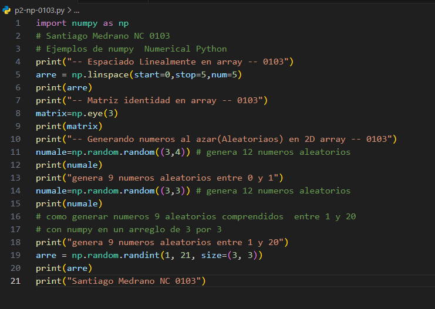
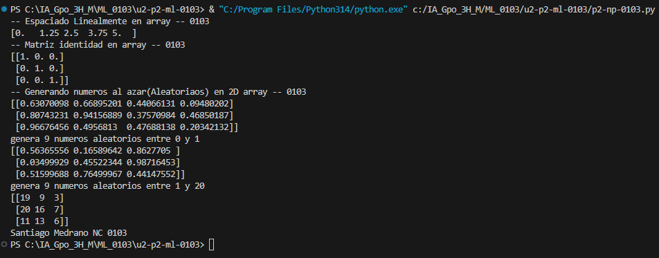

En el código:

```
arre = np.linspace(start=0, stop=1, num=5)
```

Parámetros:

1. start=0: Indica el valor inicial de la secuencia. En este caso, comienza en 0.
2. stop=1: Indica el valor final de la secuencia. En este caso, termina en 1.
3. num=5: Indica la cantidad de números que se van a generar. En este caso, genera 5 números.

## Que es np.linspace
En pocas palabras: linspace() sirve para generar números con la misma separación entre ellos, dentro de un rango establecido.

## El codigo


## Resultado
